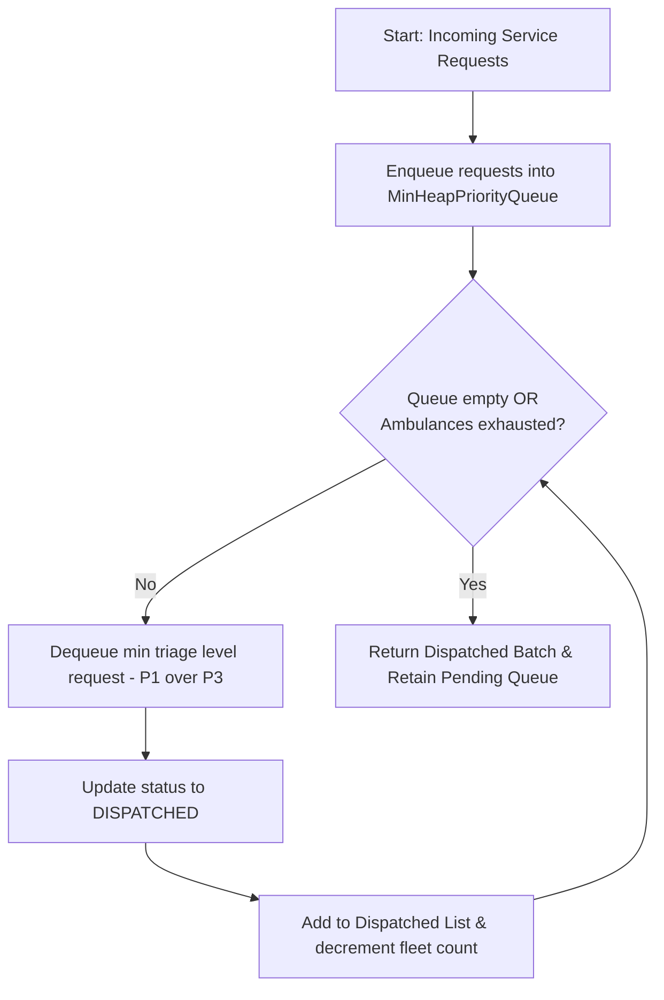
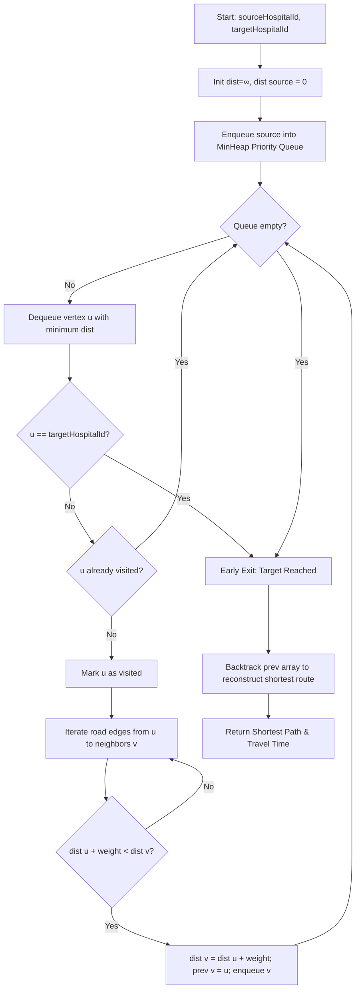
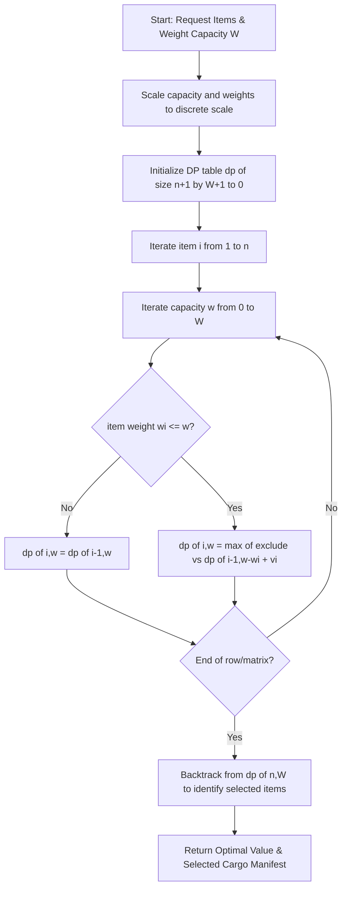
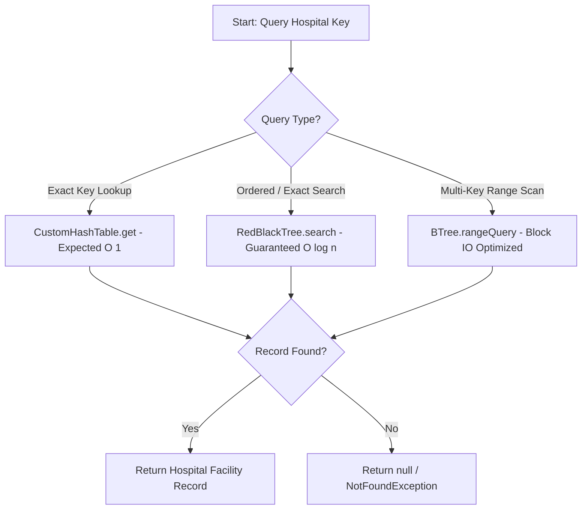
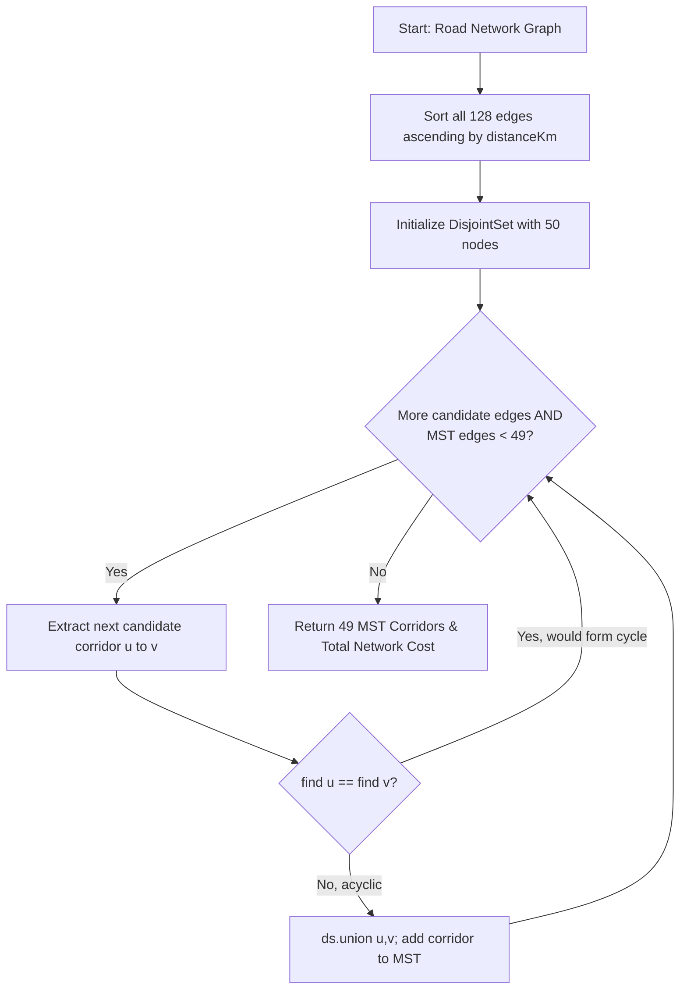
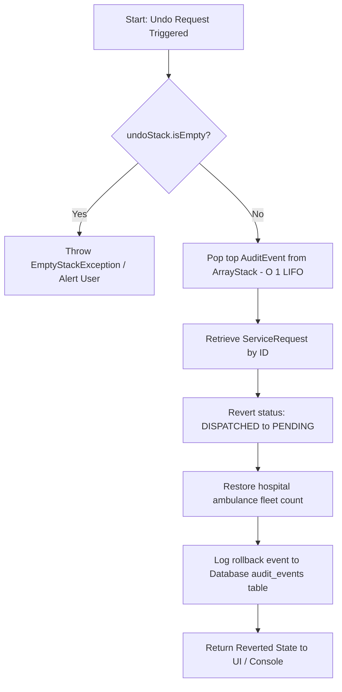
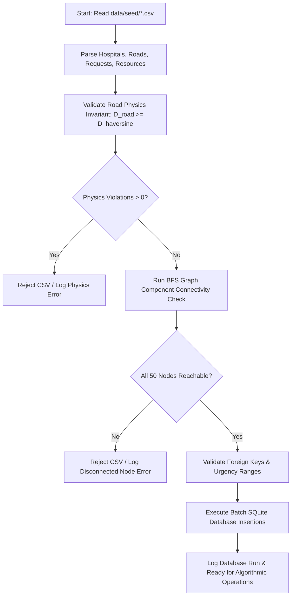

**Assigned Pod**: Pod 6 / Redeemer Jerrey Kow Williams (ID: `22394472`)  
**Reference Requirement**: DCIT 204/308 Joint Project Brief (Module M1, M2, M5, M7, M8 & Section 7)  
**Related Issue**: GitHub Issue #40 — Create Flowcharts & Formal Pseudocode  

---

## 1. Overview & Operational Architecture

This document specifies formal pseudocode, input/output contracts, preconditions/postconditions, and interactive Mermaid flowcharts for the **seven core operations** of the **Ghana Smart Hospital Operations Optimizer**. 

The operations map directly to our custom data structure library (`datastructures` module), algorithmic engines (`algorithms` module), and SQLite persistence layer (`db` module):

1. **Emergency Request Triage & Fleet Dispatch** (`MinHeapPriorityQueue`, Greedy Strategy)
2. **Shortest Hospital Route Navigation** (`HospitalNetworkGraph`, Dijkstra's Algorithm)
3. **Emergency Supply Payload Optimization** (`0/1 Knapsack Dynamic Programming`, `CapacityOptimizer`)
4. **Hospital Facility Search & Multi-Tier Indexing** (`RedBlackTree`, `CustomHashTable`, `BTree`)
5. **Regional Healthcare Infrastructure Connectivity** (`KruskalMST`, `PrimMST`, `DisjointSet`)
6. **Stack-Based Dispatch Undo & System Audit Log** (`ArrayStack`, `AuditEvent`)
7. **Dataset Ingestion & Physical Invariant Validation Pipeline** (`GraphValidation`, `CsvImporter`)

---

## Operation 1: Emergency Request Triage & Fleet Dispatch
**Target Module**: `algorithms` & `datastructures` · **Data Structure**: `MinHeapPriorityQueue<ServiceRequest>`

### 1.1 Input / Output Specification
- **Input**:
  - `requests`: Stream or list of incoming `ServiceRequest` objects (each with `patientTriageLevel`: 1=Critical, 2=Urgent, 3=Normal, and `timestampCreated`).
  - `ambulancesAvailable`: Integer count $k \ge 0$ of stationed emergency vehicles.
- **Output**:
  - `dispatched`: Ordered `DynamicArrayList<ServiceRequest>` of requests dispatched in strict priority order.

### 1.2 Preconditions & Postconditions
- **Preconditions**:
  - Each `ServiceRequest` implements `Comparable<ServiceRequest>` where comparison is ordered by `patientTriageLevel` ascending (Level 1 before Level 3), then by `timestampCreated` ascending as a FIFO tiebreaker.
  - `ambulancesAvailable >= 0`.
- **Postconditions**:
  - Exactly $\min(k, \text{totalRequests})$ highest-urgency jobs are assigned and returned.
  - Remaining undispatched requests retain min-heap ordering for subsequent dispatch intervals.
  - Heap invariant ($\text{parent} \le \text{children}$) is preserved across all operations.

### 1.3 Pseudocode
```text
FUNCTION triageAndDispatch(requests: List<ServiceRequest>, ambulancesAvailable: int) -> List<ServiceRequest>
    queue ← new MinHeapPriorityQueue<ServiceRequest>()

    FOR each req IN requests:
        queue.enqueue(req)                          // O(log n) heap insertion

    dispatched ← new DynamicArrayList<ServiceRequest>()
    assignedCount ← 0

    WHILE NOT queue.isEmpty() AND assignedCount < ambulancesAvailable:
        topRequest ← queue.dequeue()               // O(log n) extract min triage score
        topRequest.setStatus("DISPATCHED")
        dispatched.add(topRequest)
        assignedCount ← assignedCount + 1

    RETURN dispatched
END FUNCTION
```

### 1.4 Mermaid Flowchart


---

## Operation 2: Shortest Hospital Route Navigation (Dijkstra)
**Target Module**: `algorithms` · **Data Structures**: `HospitalNetworkGraph`, `MinHeapPriorityQueue<VertexDistPair>`

### 2.1 Input / Output Specification
- **Input**:
  - `graph`: `HospitalNetworkGraph` with 50 vertices and 128 highway corridors.
  - `sourceHospitalId`: Origin hospital ID ($1 \le s \le 50$).
  - `targetHospitalId`: Destination hospital ID ($1 \le t \le 50$).
- **Output**:
  - `ShortestPathResult`: Contains total driving distance ($km$), travel duration ($mins$), and the reconstructed sequence of intermediate hospital nodes.

### 2.2 Preconditions & Postconditions
- **Preconditions**:
  - All road edge weights are non-negative: $\forall (u, v) \in E, \text{weight}(u, v) \ge 0$.
  - `sourceHospitalId` and `targetHospitalId` exist in the graph.
- **Postconditions**:
  - Distance array `dist[v]` represents the minimal cumulative distance from `sourceHospitalId` to all reachable nodes $v$.
  - Predecessor array `prev[v]` allows backwards path reconstruction from destination to origin in $O(|V|)$ time.

### 2.3 Pseudocode
```text
FUNCTION findShortestRoute(graph: HospitalNetworkGraph, sourceId: int, targetId: int) -> PathResult
    n ← graph.vertexCount()
    dist ← array of size n, initialized to ∞
    prev ← array of size n, initialized to -1
    visited ← boolean array of size n, initialized to false

    dist[sourceId] ← 0.0
    pq ← new MinHeapPriorityQueue<VertexDistPair>()
    pq.enqueue(new VertexDistPair(sourceId, 0.0))

    WHILE NOT pq.isEmpty():
        current ← pq.dequeue()
        u ← current.vertexId
        IF visited[u]: CONTINUE
        visited[u] ← true
        IF u == targetId: BREAK                      // Early exit upon reaching target

        FOR each edge IN graph.getOutgoingEdges(u):
            v ← edge.destinationId
            newDist ← dist[u] + edge.distanceKm
            IF NOT visited[v] AND newDist < dist[v]:
                dist[v] ← newDist
                prev[v] ← u
                pq.enqueue(new VertexDistPair(v, newDist))

    path ← reconstructPath(prev, sourceId, targetId)
    RETURN new PathResult(dist[targetId], path)
END FUNCTION
```

### 2.4 Mermaid Flowchart


---

## Operation 3: Emergency Supply Payload Optimization (0/1 Knapsack DP)
**Target Module**: `algorithms` · **Class**: `CapacityOptimizer` · **Data Structure**: `DynamicArrayList<Integer>`

### 3.1 Input / Output Specification
- **Input**:
  - `requests`: Array of pending equipment/supply requests with `weightKg` and priority `value`.
  - `maxPayloadCapacity`: Derived vehicle cargo capacity threshold ($W = 134.0\text{ kg}$).
- **Output**:
  - `OptimizationResult`: Maximum combined priority score, actual total loaded weight ($kg$), and list of selected request IDs.

### 3.2 Preconditions & Postconditions
- **Preconditions**:
  - `weights.length == values.length == n` with $\forall i, \text{weight}[i] > 0$.
  - `maxPayloadCapacity > 0`.
- **Postconditions**:
  - $\sum_{i \in \text{selected}} \text{weight}[i] \le \text{maxPayloadCapacity}$.
  - The sum $\sum_{i \in \text{selected}} \text{value}[i]$ is globally optimal subject to the 0/1 item constraint.

### 3.3 Pseudocode
```text
FUNCTION optimizeSupplyPayload(requests: List<ServiceRequest>, maxCapacity: double) -> OptimizationResult
    n ← requests.size()
    SCALE ← 10                                       // Fixed-point scaling for 0.1kg precision
    W ← round(maxCapacity * SCALE)
    
    dp ← 2D array [0..n][0..W], initialized to 0

    FOR i FROM 1 TO n:
        wi ← round(requests[i-1].getWeightKg() * SCALE)
        vi ← requests[i-1].getPriorityScore()
        FOR w FROM 0 TO W:
            dp[i][w] ← dp[i-1][w]                   // Exclude item i-1
            IF wi <= w:
                included ← dp[i-1][w - wi] + vi
                IF included > dp[i][w]:
                    dp[i][w] ← included              // Include item i-1

    selectedList ← new DynamicArrayList<ServiceRequest>()
    currW ← W
    FOR i FROM n DOWN TO 1:
        IF dp[i][currW] != dp[i-1][currW]:
            selectedList.add(requests[i-1])
            currW ← currW - round(requests[i-1].getWeightKg() * SCALE)

    RETURN new OptimizationResult(dp[n][W], selectedList)
END FUNCTION
```

### 3.4 Mermaid Flowchart


---

## Operation 4: Hospital Facility Search & Multi-Tier Indexing
**Target Module**: `datastructures` · **Data Structures**: `RedBlackTree<K,V>`, `CustomHashTable<K,V>`, `BTree<K,V>`

### 4.1 Input / Output Specification
- **Input**: Search query (either numeric `hospitalId` or text `hospitalName`).
- **Output**: The matched `Hospital` facility record or `null` if non-existent.

### 4.2 Preconditions & Postconditions
- **Preconditions**:
  - `RedBlackTree` keys implement `Comparable<K>` for total ordering.
  - `CustomHashTable` key objects implement non-null `hashCode()` and `equals()`.
- **Postconditions**:
  - Exact key lookup in `CustomHashTable` returns in expected $O(1)$ time.
  - Ordered range queries and key search in `RedBlackTree` return in guaranteed $O(\log n)$ time.

### 4.3 Pseudocode
```text
FUNCTION findHospital(key: int, mode: SearchMode) -> Hospital
    IF mode == EXACT_HASH_LOOKUP:
        RETURN hospitalHashTable.get(key)             // Expected O(1) bucket probe
    ELSE IF mode == BALANCED_TREE_LOOKUP:
        RETURN hospitalRedBlackTree.search(key)      // Guaranteed O(log n)
    ELSE IF mode == RANGE_SCAN:
        RETURN hospitalBTree.rangeQuery(key.min, key.max)
    END IF
END FUNCTION
```

### 4.4 Mermaid Flowchart


---

## Operation 5: Regional Healthcare Infrastructure Connectivity (MST)
**Target Module**: `algorithms` · **Classes**: `KruskalMST`, `PrimMST`, `DisjointSet`

### 5.1 Input / Output Specification
- **Input**: Connected `HospitalNetworkGraph` (50 hospital nodes, 128 road edges).
- **Output**: Minimum Spanning Tree edge list of size $|V|-1 = 49$ edges and total network road length ($km$).

### 5.2 Preconditions & Postconditions
- **Preconditions**:
  - Graph is connected (confirmed via BFS component check).
- **Postconditions**:
  - Result contains exactly 49 acyclic edges spanning all 50 hospitals.
  - Total road corridor cost is mathematically minimal.

### 5.3 Pseudocode
```text
FUNCTION computeRegionalMST_Kruskal(graph: HospitalNetworkGraph) -> MSTResult
    edges ← graph.getAllEdges()
    QuickSort.sort(edges)                             // Sort O(E log E) by distanceKm

    ds ← new DisjointSet(graph.vertexCount())
    mstEdges ← new DynamicArrayList<Route>()
    totalKm ← 0.0

    FOR each edge (u, v, dist) IN edges:
        rootU ← ds.find(u)
        rootV ← ds.find(v)
        IF rootU != rootV:                           // No cycle formed
            ds.union(rootU, rootV)
            mstEdges.add(edge)
            totalKm ← totalKm + dist
            IF mstEdges.size() == graph.vertexCount() - 1:
                BREAK

    RETURN new MSTResult(mstEdges, totalKm)
END FUNCTION
```

### 5.4 Mermaid Flowchart


---

## Operation 6: Stack-Based Dispatch Undo & System Audit Trail
**Target Module**: `datastructures` · **Class**: `ArrayStack<AuditEvent>` (Brief Section 4 & Module M5)

### 6.1 Input / Output Specification
- **Input**: User/Examiner triggering an `undoLastAction()` or system event emission (`AuditEvent`).
- **Output**: Rollback of the last dispatch state and restoration of the previous request status.

### 6.2 Preconditions & Postconditions
- **Preconditions**:
  - `undoStack` is non-empty (`!undoStack.isEmpty()`).
- **Postconditions**:
  - The most recent dispatch event is popped in $O(1)$ time.
  - The assigned vehicle fleet is decremented/incremented back to original state.
  - The target request status reverts from `DISPATCHED` to `PENDING`.

### 6.3 Pseudocode
```text
FUNCTION undoLastDispatch(undoStack: ArrayStack<AuditEvent>) -> AuditEvent
    IF undoStack.isEmpty():
        THROW new EmptyStackException("No actions available to undo")

    lastEvent ← undoStack.pop()                       // O(1) LIFO pop
    targetRequest ← serviceRequestRepo.findById(lastEvent.getRequestId())
    
    // Revert state
    targetRequest.setStatus(lastEvent.getPreviousStatus())
    serviceRequestRepo.save(targetRequest)
    
    // Reclaim fleet resource
    hospitalRepo.incrementAmbulanceCount(lastEvent.getAssignedHospitalId())

    RETURN lastEvent
END FUNCTION
```

### 6.4 Mermaid Flowchart


---

## Operation 7: Dataset Ingestion & Physics Invariant Validation Pipeline
**Target Module**: `db` · **Classes**: `CsvImporter`, `GraphValidator` (Brief Module M2 & Section 2.i)

### 7.1 Input / Output Specification
- **Input**: Raw seed CSV files (`hospitals.csv`, `roads.csv`, `service_requests.csv`, `medical_resources.csv`).
- **Output**: Populated SQLite database and validation report verifying graph connectivity and road physics.

### 7.2 Preconditions & Postconditions
- **Preconditions**:
  - CSV files exist in `data/seed/` with valid UTF-8 headers.
- **Postconditions**:
  - $\forall (u, v) \in \text{roads}, \text{distanceKm}(u, v) \ge \text{haversine}(u, v)$ (Zero physics violations).
  - Graph has exactly 1 connected component (50/50 facilities reachable via BFS).
  - All foreign keys are referentially valid.

### 7.3 Pseudocode
```text
FUNCTION validateAndIngestSeedData() -> ValidationSummary
    hospitals ← CsvParser.readHospitals("data/seed/hospitals.csv")
    roads ← CsvParser.readRoads("data/seed/roads.csv")

    // 1. Road Physics Invariant Check
    FOR each road IN roads:
        h1 ← hospitals.get(road.fromHospitalId)
        h2 ← hospitals.get(road.toHospitalId)
        havDist ← calculateHaversine(h1.lat, h1.lng, h2.lat, h2.lng)
        IF road.distanceKm < havDist:
            THROW new PhysicsViolationException("Road distance violates spherical bound")

    // 2. Graph Component Reachability Check
    graph ← buildGraph(hospitals, roads)
    reachedNodes ← BFS.traverse(graph, startNode=1)
    IF reachedNodes.size() < hospitals.size():
        THROW new DisconnectedGraphException("Graph contains isolated facilities")

    // 3. Batch SQLite Persistence
    dbTransaction.begin()
    hospitalRepo.saveAll(hospitals)
    routeRepo.saveAll(roads)
    dbTransaction.commit()

    RETURN new ValidationSummary(hospitals.size(), roads.size(), status="PASSED")
END FUNCTION
```

### 7.4 Mermaid Flowchart


---

## 8. Master Summary Table

| # | System Operation | Primary Algorithm | Core Data Structure | Time Complexity | Module |
|:---:|:---|:---|:---|:---:|:---:|
| **1** | **Triage & Dispatch** | Greedy Urgency Prioritization | `MinHeapPriorityQueue` | $O(n \log n)$ total, $O(\log n)$ per job | `algorithms` |
| **2** | **Shortest Route** | Dijkstra's Shortest Path | `HospitalNetworkGraph` + `MinHeap` | $O((|V| + |E|) \log |V|)$ | `algorithms` |
| **3** | **Payload Optimization** | 0/1 Knapsack Dynamic Programming | `DynamicArrayList` (DP Table) | $O(n \times W)$ pseudo-polynomial | `algorithms` |
| **4** | **Facility Search** | Balanced Search & Hash Probing | `RedBlackTree` / `CustomHashTable` | $O(\log n)$ / expected $O(1)$ | `datastructures` |
| **5** | **Regional Connectivity** | Kruskal / Prim MST | `DisjointSet` / `MinHeapPriorityQueue` | $O(|E| \log |E|)$ / $O(|E| \log |V|)$ | `algorithms` |
| **6** | **Dispatch Undo Log** | LIFO State Rollback | `ArrayStack` (Audit Stack) | $O(1)$ push / pop | `datastructures` |
| **7** | **Seed Data Ingestion** | BFS Reachability & Physics Verification | `HospitalNetworkGraph` + `Database` | $O(|V| + |E|)$ | `db` |
