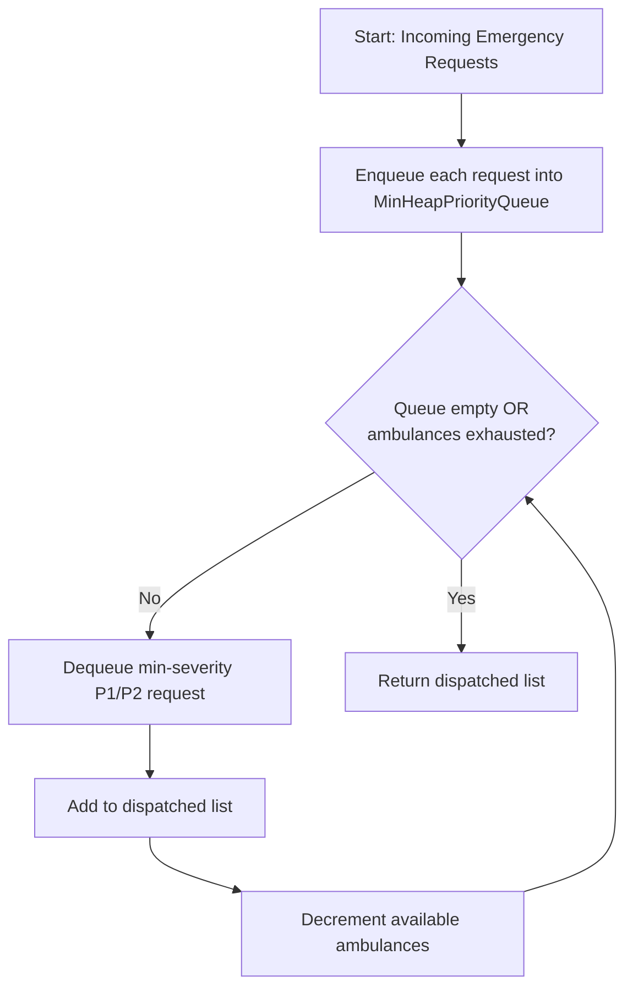
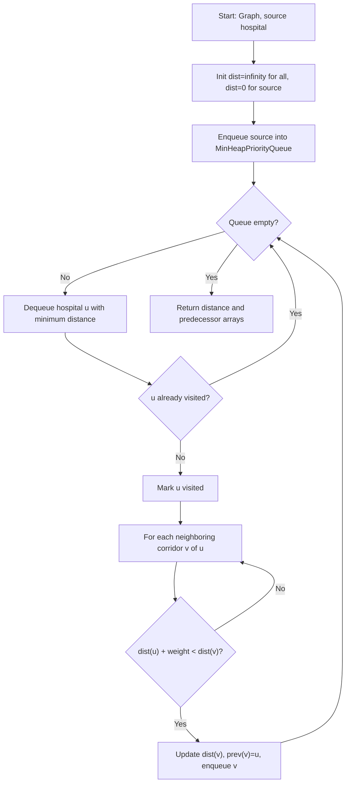
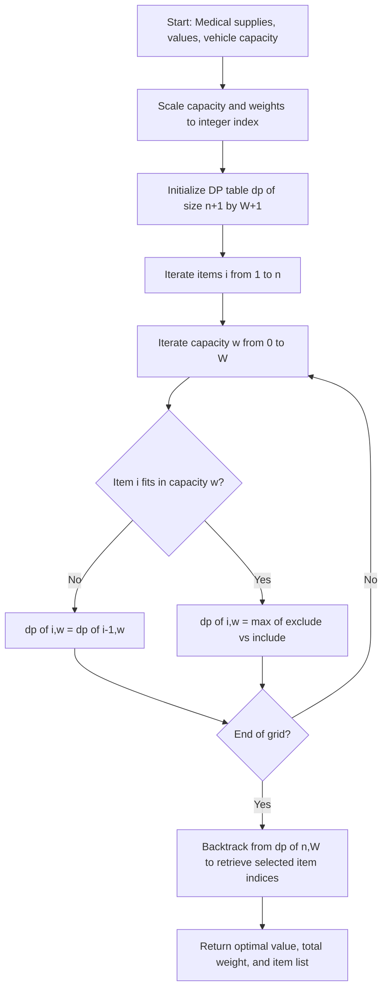
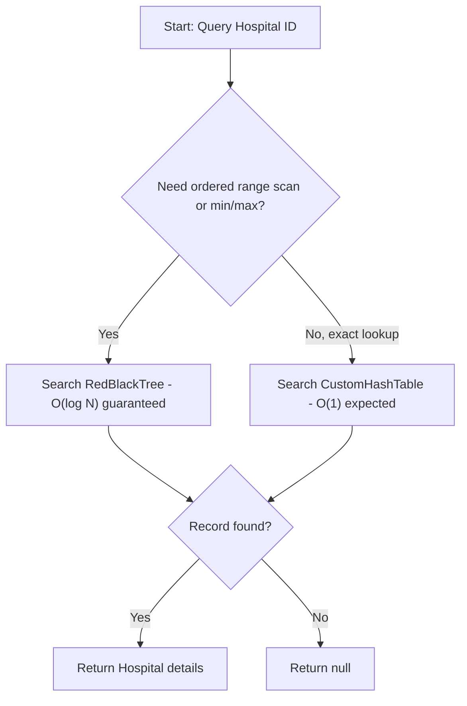
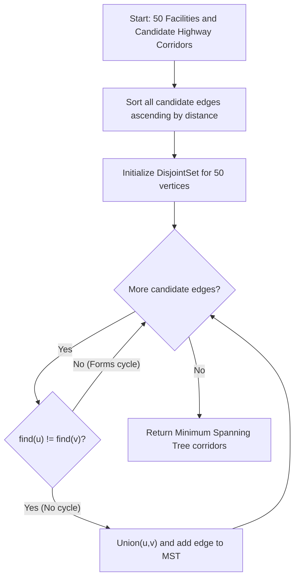
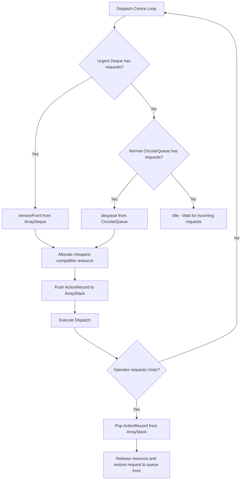

# Flowcharts & Formal Pseudocode — Major System Operations

Issue #40 · Project Brief Module M1 & Section 7

This document specifies formal pseudocode, input/output contracts, preconditions/postconditions, and Mermaid flowcharts for the major operations of the **Ghana Smart Hospital Operations Optimizer**.

Every operation is strictly mapped to our custom data structures (`HospitalNetworkGraph`, `MinHeapPriorityQueue`, `ArrayStack`, `ArrayDeque`, `CircularQueue`, `DynamicArrayList`, `SinglyLinkedList`, `DoublyLinkedList`, `RedBlackTree`, `BinarySearchTree`, `BTree`, `CustomHashTable`, `DisjointSet`, and `CapacityOptimizer`).

---

## Data Structure to Hospital Operations Mapping Matrix

| Custom Data Structure | Ghanaian Hospital Operations Role | Primary Operation | Time Complexity |
|:---|:---|:---|:---:|
| **`MinHeapPriorityQueue<T>`** | Triage dispatch priority (P1 Critical -> P2 Urgent -> P3 Normal) | Op 1, Op 2, Op 5 | O(log N) |
| **`HospitalNetworkGraph`** | 50 Ghanaian facilities & 128 highway corridors (OSM/OSRM road distances) | Op 2, Op 5 | O(V + E) |
| **`DynamicArrayList<T>`** | Resizable containers for dispatch batches & DP knapsack backtracking | Op 1, Op 3 | O(1) amortized |
| **`ArrayStack<T>`** | LIFO audit log & rollback engine for ambulance dispatch undos | Op 6 | O(1) |
| **`ArrayDeque<T>`** | Head/tail insertion for emergency preempted patient transfers | Op 6 | O(1) amortized |
| **`CircularQueue<T>`** | Fixed-capacity ring buffer for routine clinical patient admission | Op 6 | O(1) |
| **`SinglyLinkedList<T>`** | Sequential step logging of emergency ambulance transit waypoints | Op 2 | O(1) insert |
| **`DoublyLinkedList<T>`** | Bidirectional audit history & medical inventory transaction logs | Op 4 | O(1) insert |
| **`RedBlackTree<K,V>`** | Balanced logarithmic search & range queries on ICU bed capacities | Op 4 | O(log N) |
| **`BinarySearchTree<K,V>`** | Hierarchical search tree for facility district classifications | Op 4 | O(log N) |
| **`B-Tree<K,V>` (t=2)** | Multi-way search tree simulating disk-block patient indexing | Op 4 | O(log_t N) |
| **`CustomHashTable<K,V>`** | Constant-time facility ID and medical resource inventory lookups | Op 4 | O(1) expected |
| **`DisjointSet`** | Union-Find with path compression for network component connectivity | Op 5 | O(alpha(V)) |

---

## 1. Emergency Request Triage & Priority Dispatch
**Target Components:** `MinHeapPriorityQueue<EmergencyRequest>`, `DynamicArrayList<EmergencyRequest>`

### Input / Output
- **Input:** Stream of incoming `EmergencyRequest` items, each with `triageLevel` (1=Critical, 2=Urgent, 3=Normal), `requestId`, and `timestamp`; available fleet count `ambulancesAvailable`.
- **Output:** Ordered `DynamicArrayList<EmergencyRequest>` of dispatched emergency allocations in strict triage priority order.

### Preconditions
- Each `EmergencyRequest` implements natural comparison: P1 Critical precedes P2 Urgent; earlier timestamp breaks ties.
- `ambulancesAvailable >= 0`.

### Postconditions
- Dispatched requests follow strict min-heap priority order.
- The heap invariant (`parent <= children`) is preserved after all insertions and extractions.

### Pseudocode
```
FUNCTION triageDispatch(requests: DynamicArrayList<EmergencyRequest>, ambulancesAvailable: int) -> DynamicArrayList<EmergencyRequest>
    queue <- new MinHeapPriorityQueue<EmergencyRequest>()

    FOR each r IN requests:
        queue.enqueue(r)                      // O(log N) heapify-up

    dispatched <- new DynamicArrayList<EmergencyRequest>()
    count <- 0

    WHILE NOT queue.isEmpty() AND count < ambulancesAvailable:
        next <- queue.dequeue()               // O(log N) heapify-down, extracts highest priority
        dispatched.add(next)
        count <- count + 1

    RETURN dispatched
END FUNCTION
```

### Flowchart


---

## 2. Shortest Hospital Route Navigation (Dijkstra)
**Target Components:** `HospitalNetworkGraph`, `MinHeapPriorityQueue<VertexDistPair>`, `DynamicArrayList<Integer>`

### Input / Output
- **Input:** A weighted `HospitalNetworkGraph` (50 Ghanaian facilities, 128 highway corridors), `sourceHospitalId` (e.g. 1 = Korle Bu).
- **Output:** `dist[]` (shortest driving distance in km to all 50 hospitals) and `prev[]` (predecessor path reconstruction array).

### Preconditions
- All road edge weights (`distance_km`) are non-negative (`weight >= 0`).
- `sourceHospitalId` is within valid range `[0, vertexCount - 1]`.

### Postconditions
- `dist[sourceHospitalId] == 0`.
- For every reachable facility `v`, `dist[v]` is the minimal cumulative road distance from source.
- Unreachable facilities retain `dist[v] = infinity` and `prev[v] = null`.

### Pseudocode
```
FUNCTION dijkstra(graph: HospitalNetworkGraph, sourceHospitalId: int) -> (dist[], prev[])
    n <- graph.vertexCount()
    dist <- array of size n, filled with infinity
    prev <- array of size n, filled with null
    dist[sourceHospitalId] <- 0

    pq <- new MinHeapPriorityQueue<VertexDistPair>()
    pq.enqueue((sourceHospitalId, 0.0))
    visited <- boolean array of size n, all false

    WHILE NOT pq.isEmpty():
        (u, d) <- pq.dequeue()
        IF visited[u]: CONTINUE
        visited[u] <- true

        FOR each edge IN graph.getNeighbors(u):
            v <- edge.destination
            weight <- edge.weight
            IF NOT visited[v] AND dist[u] + weight < dist[v]:
                dist[v] <- dist[u] + weight
                prev[v] <- u
                pq.enqueue((v, dist[v]))

    RETURN (dist, prev)
END FUNCTION
```

### Flowchart


---

## 3. Medical Supply Vehicle Loading (0/1 Knapsack DP)
**Target Components:** `CapacityOptimizer`, `OptimizationResult`, `DynamicArrayList<Integer>`

### Input / Output
- **Input:** `weights[]` (supply item weights in kg), `values[]` (clinical priority scores), `capacity` (vehicle maximum payload in kg).
- **Output:** `OptimizationResult` containing `totalValue`, `totalWeight`, and `selectedIndices`.

### Preconditions
- `weights.length == values.length == n`.
- All item weights `weights[i] >= 0` and vehicle `capacity >= 0`.

### Postconditions
- Total selected payload `totalWeight <= capacity`.
- `totalValue` is optimal across all $2^n$ possible supply combinations (0/1 constraint: each supply pack selected at most once).

### Pseudocode
```
FUNCTION optimizeCapacity(weights: double[], values: double[], capacity: double) -> OptimizationResult
    n <- weights.length
    W <- round(capacity * 10)                 // Scale for 0.1 kg resolution
    scaledWeights <- array of size n
    FOR i FROM 0 TO n-1:
        scaledWeights[i] <- round(weights[i] * 10)

    dp <- 2D array [0..n][0..W], initialized to 0.0

    FOR i FROM 1 TO n:
        wi <- scaledWeights[i-1]
        vi <- values[i-1]
        FOR w FROM 0 TO W:
            dp[i][w] <- dp[i-1][w]             // Option 1: Exclude item i-1
            IF wi <= w:
                included <- dp[i-1][w - wi] + vi
                IF included > dp[i][w]:
                    dp[i][w] <- included       // Option 2: Include item i-1

    selectedIndices <- new DynamicArrayList<Integer>()
    w <- W
    totalWeight <- 0.0
    FOR i FROM n DOWN TO 1:
        IF dp[i][w] != dp[i-1][w]:
            selectedIndices.add(i-1)           // Item i-1 was included
            w <- w - scaledWeights[i-1]
            totalWeight <- totalWeight + weights[i-1]

    RETURN OptimizationResult(dp[n][W], totalWeight, selectedIndices)
END FUNCTION
```

### Flowchart


---

## 4. Hospital Facility Search & Key-Value Indexing
**Target Components:** `RedBlackTree<K,V>`, `CustomHashTable<K,V>`, `BTree<K,V>`, `BinarySearchTree<K,V>`

### Input / Output
- **Input:** `hospitalId` / `facilityName` query key.
- **Output:** Matching `Hospital` record or `null` if not found.

### Preconditions
- Keys for tree indexing implement `Comparable<K>`.
- Keys for `CustomHashTable` implement proper `hashCode()` and `equals()`.

### Postconditions
- **Red-Black Tree**: Search completes in guaranteed $O(\log N)$ worst-case time.
- **Custom Hash Table**: Search completes in $O(1)$ expected time with quadratic probing collision resolution.
- **B-Tree ($t=2$)**: Multi-way page search completes in $O(\log_t N)$ time.

### Pseudocode
```
// 1. Balanced Tree Indexing (Guaranteed Logarithmic Time)
FUNCTION searchFacilityByTree(tree: RedBlackTree<Integer, Hospital>, id: int) -> Hospital
    RETURN tree.search(id)                     // O(log N) root-to-leaf binary search
END FUNCTION

// 2. Hash Table Indexing (Constant-Time Fast Cache)
FUNCTION searchFacilityByHash(table: CustomHashTable<Integer, Hospital>, id: int) -> Hospital
    RETURN table.get(id)                       // O(1) hash -> bucket -> quadratic probe
END FUNCTION
```

### Flowchart


---

## 5. Regional Infrastructure Connectivity (Minimum Spanning Tree)
**Target Components:** `HospitalNetworkGraph`, `DisjointSet`, `KruskalMST`, `PrimMST`, `MinHeapPriorityQueue`

### Input / Output
- **Input:** A connected `HospitalNetworkGraph` of 50 Ghanaian facilities and potential transit corridors.
- **Output:** Minimum Spanning Tree edge list connecting all facilities with minimum total road construction distance.

### Preconditions
- Graph is connected and undirected.
- Edge weights represent non-negative highway distances.

### Postconditions
- Resulting tree contains exactly $V - 1$ edges and zero cycles.
- Total road distance $\sum w(e)$ is mathematically minimal.

### Pseudocode
```
// Kruskal's Algorithm with Disjoint-Set Union-Find
FUNCTION kruskalMST(graph: HospitalNetworkGraph) -> DynamicArrayList<Edge>
    edges <- graph.getAllEdgesSorted()        // Sorted by distance ascending
    ds <- new DisjointSet(graph.vertexCount())
    mst <- new DynamicArrayList<Edge>()

    FOR each edge (u, v, w) IN edges:
        IF ds.find(u) != ds.find(v):          // No cycle formed
            ds.union(u, v)                    // Union by rank with path compression
            mst.add(edge)

    RETURN mst
END FUNCTION
```

### Flowchart


---

## 6. Multi-Tier Triage Dispatch & Stack-Based Rollback Engine
**Target Components:** `ArrayDeque<ServiceRequest>`, `CircularQueue<ServiceRequest>`, `ArrayStack<ActionRecord>`, `HospitalDispatchCentre`

### Input / Output
- **Input:** High-urgency preemptions, routine admissions, and operator undo signals.
- **Output:** Dispatched ambulance units, updated triage queues, and stack-managed rollback execution.

### Preconditions
- Urgent preemption queue (`ArrayDeque`) accepts front/rear insertions.
- Normal admissions queue (`CircularQueue`) operates as a fixed-capacity ring buffer.
- Undo history is stored in an `ArrayStack` (LIFO).

### Postconditions
- Critical P1 patients preempt routine P3 patients.
- Triggering `undo()` precisely restores the previous dispatch state, re-admitting requests and releasing assigned equipment.

### Pseudocode
```
FUNCTION serveNextRequest(centre: HospitalDispatchCentre) -> DispatchAssignment
    // Priority Tier 1: Emergency Preemptions (ArrayDeque)
    IF NOT centre.urgentDeque.isEmpty():
        req <- centre.urgentDeque.removeFront()
        resource <- centre.pool.allocate(req.requestType)
        action <- new ActionRecord("SERVE_URGENT", req, resource)
        centre.undoStack.push(action)
        RETURN new DispatchAssignment(req, resource)

    // Priority Tier 2: Normal Admissions (CircularQueue)
    IF NOT centre.normalQueue.isEmpty():
        req <- centre.normalQueue.dequeue()
        resource <- centre.pool.allocate(req.requestType)
        action <- new ActionRecord("SERVE_NORMAL", req, resource)
        centre.undoStack.push(action)
        RETURN new DispatchAssignment(req, resource)

    RETURN null                               // No pending requests
END FUNCTION

FUNCTION undoLastAction(centre: HospitalDispatchCentre) -> ActionRecord
    IF centre.undoStack.isEmpty():
        RETURN null

    lastAction <- centre.undoStack.pop()       // LIFO stack rollback
    IF lastAction.actionType == "SERVE_URGENT":
        centre.pool.release(lastAction.resource)
        centre.urgentDeque.addFront(lastAction.request)
    ELSE IF lastAction.actionType == "SERVE_NORMAL":
        centre.pool.release(lastAction.resource)
        centre.normalQueue.enqueue(lastAction.request)

    RETURN lastAction
END FUNCTION
```

### Flowchart

