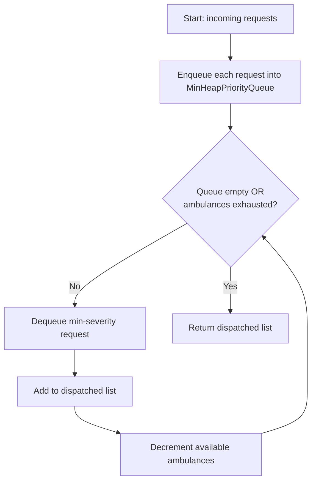
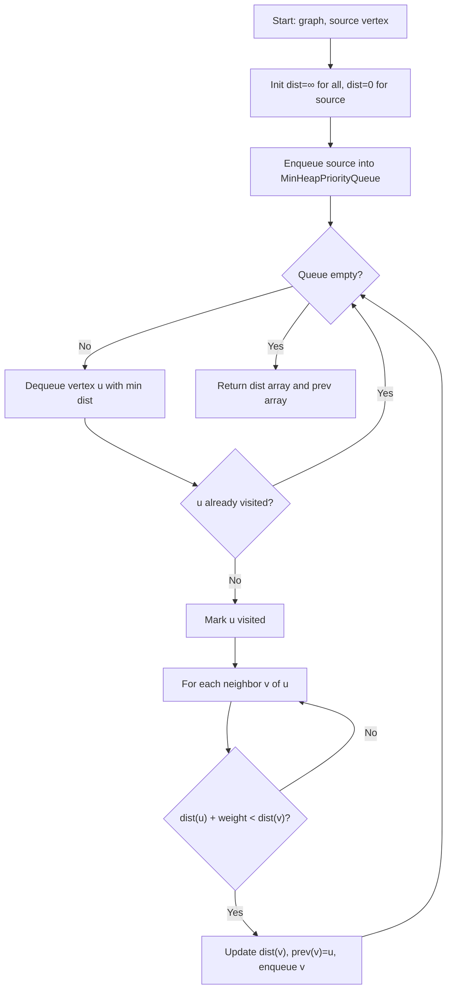
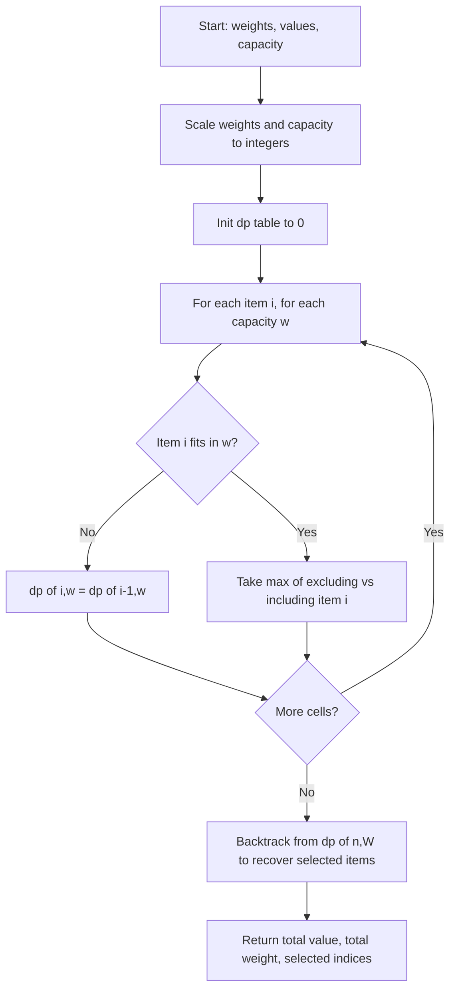
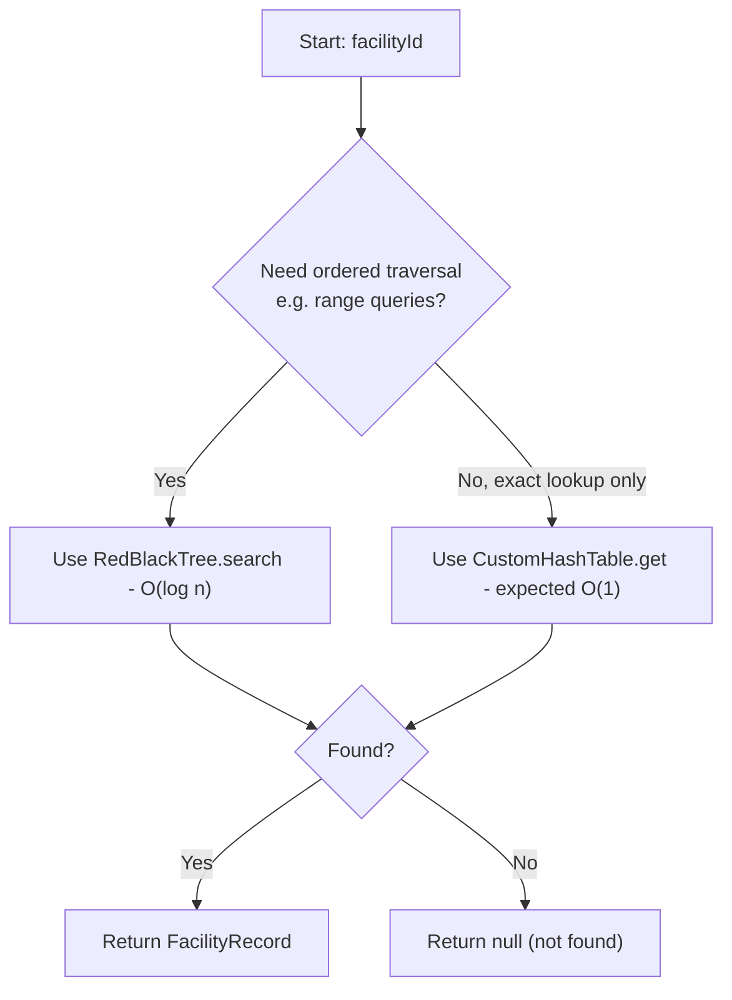
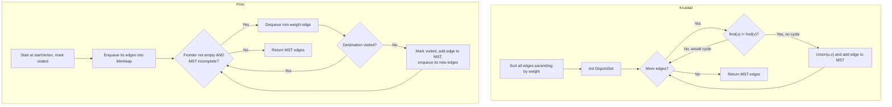

# Flowcharts & Formal Pseudocode — 5 Major System Operations

Issue #40 · Project Brief Module M1 & Section 7

This document specifies formal pseudocode, input/output contracts,
preconditions/postconditions, and a Mermaid flowchart for five major
operations of the Ghana Smart Hospital Operations Optimizer. Pseudocode is
written to match the real method signatures already implemented in the
codebase where those classes exist (`HospitalNetworkGraph`,
`MinHeapPriorityQueue`, `RedBlackTree`, `CustomHashTable`, `KruskalMST`,
`PrimMST`, `DisjointSet`, `CapacityOptimizer`). Where an operation itself is
not yet implemented as its own class (e.g. Dijkstra, Triage Dispatch), the
pseudocode specifies the contract it should be built against.

---

## 1. Emergency Request Triage & Dispatch
**Data structures:** `MinHeapPriorityQueue<T>` (Pod 4) · Greedy dispatch strategy (Pod 6)

### Input / Output
- **Input:** a stream of `EmergencyRequest` objects, each with a severity
  score (lower = more urgent) and arrival timestamp; an `ambulancesAvailable`
  count.
- **Output:** an ordered `DynamicArrayList<EmergencyRequest>` of dispatched
  requests, in the order they should be sent out.

### Preconditions
- Each `EmergencyRequest` implements `Comparable` ordered by severity, then
  by arrival time as a tiebreaker.
- `ambulancesAvailable >= 0`.

### Postconditions
- The `ambulancesAvailable` most urgent (lowest severity value) requests are
  returned first, in strict priority order.
- Requests left in the queue remain queued for the next dispatch cycle.
- The priority queue's heap invariant (`parent <= children`) holds after
  every `enqueue`/`dequeue`.

### Pseudocode
```
FUNCTION triageDispatch(requests: List<EmergencyRequest>, ambulancesAvailable: int) -> List<EmergencyRequest>
    queue ← new MinHeapPriorityQueue<EmergencyRequest>()

    FOR each r IN requests:
        queue.enqueue(r)                      // O(log n) heapify-up

    dispatched ← new DynamicArrayList<EmergencyRequest>()
    count ← 0

    WHILE NOT queue.isEmpty() AND count < ambulancesAvailable:
        next ← queue.dequeue()                // O(log n) heapify-down, returns min
        dispatched.add(next)
        count ← count + 1

    RETURN dispatched
END FUNCTION
```

### Flowchart


---

## 2. Shortest Hospital Route Navigation (Dijkstra)
**Data structures:** `HospitalNetworkGraph`, `MinHeapPriorityQueue<T>` (Pod 6)

### Input / Output
- **Input:** a `HospitalNetworkGraph` (weighted, non-negative edge weights),
  a `sourceVertex` ID.
- **Output:** `dist[]` — shortest distance from source to every vertex, and
  `prev[]` — predecessor array for path reconstruction.

### Preconditions
- All edge weights returned by `graph.getWeight(u, v)` are `>= 0` (Dijkstra
  is invalid on graphs with negative weights).
- `sourceVertex` is a valid vertex index, `0 <= sourceVertex < graph.vertexCount()`.

### Postconditions
- `dist[sourceVertex] == 0`.
- For every reachable vertex `v`, `dist[v]` equals the true shortest-path
  weight from `sourceVertex`.
- Unreachable vertices retain `dist[v] == ∞` and `prev[v] == null`.
- The path from `sourceVertex` to any `v` can be rebuilt by walking `prev[]`
  backward from `v`.

### Pseudocode
```
FUNCTION dijkstra(graph: HospitalNetworkGraph, sourceVertex: int) -> (dist[], prev[])
    n ← graph.vertexCount()
    dist ← array of size n, filled with ∞
    prev ← array of size n, filled with null
    dist[sourceVertex] ← 0

    pq ← new MinHeapPriorityQueue<VertexDistPair>()
    pq.enqueue((sourceVertex, 0))
    visited ← boolean array of size n, all false

    WHILE NOT pq.isEmpty():
        (u, d) ← pq.dequeue()
        IF visited[u]: CONTINUE
        visited[u] ← true

        FOR each edge IN graph.getNeighbors(u):
            v ← edge.destination
            weight ← edge.weight
            IF NOT visited[v] AND dist[u] + weight < dist[v]:
                dist[v] ← dist[u] + weight
                prev[v] ← u
                pq.enqueue((v, dist[v]))

    RETURN (dist, prev)
END FUNCTION
```

### Flowchart


---

## 3. Capacity & Budget Request Selection (0/1 Knapsack DP)
**Data structures:** `DynamicArrayList<T>` (Pod 1) · `CapacityOptimizer` (Pod 6, Issue #22)

### Input / Output
- **Input:** `weights[]` (double, supply item weights in kg), `values[]`
  (double, priority/value score per item), `capacity` (double, max payload
  in kg).
- **Output:** `OptimizationResult` containing `totalValue`, `totalWeight`,
  and the `DynamicArrayList<Integer>` of selected item indices.

### Preconditions
- `weights.length == values.length == n`.
- All `weights[i] >= 0` and `capacity >= 0`.

### Postconditions
- `totalWeight <= capacity`.
- `totalValue` is the maximum achievable value subject to the capacity
  constraint, over all subsets of `{0, ..., n-1}` (each item used at most
  once — the 0/1 property).
- `selectedIndices` contains each chosen item's original index exactly once,
  in ascending order.

### Pseudocode
```
FUNCTION optimizeCapacity(weights: double[], values: double[], capacity: double) -> OptimizationResult
    n ← weights.length
    W ← round(capacity * SCALE)                 // integer-scale for DP indexing
    scaledWeights[i] ← round(weights[i] * SCALE) FOR i IN 0..n-1

    dp ← 2D array [0..n][0..W], all initialised to 0

    FOR i FROM 1 TO n:
        wi ← scaledWeights[i-1]
        vi ← values[i-1]
        FOR w FROM 0 TO W:
            dp[i][w] ← dp[i-1][w]                // exclude item i-1
            IF wi <= w:
                included ← dp[i-1][w - wi] + vi
                IF included > dp[i][w]:
                    dp[i][w] ← included           // include item i-1

    selectedIndices ← new DynamicArrayList<Integer>()
    w ← W
    totalWeight ← 0
    FOR i FROM n DOWN TO 1:
        IF dp[i][w] != dp[i-1][w]:
            selectedIndices.add(0, i-1)
            w ← w - scaledWeights[i-1]
            totalWeight ← totalWeight + weights[i-1]

    RETURN OptimizationResult(dp[n][W], totalWeight, selectedIndices, dp)
END FUNCTION
```

### Flowchart


---

## 4. Hospital Facility Search & Indexing
**Data structures:** `RedBlackTree<K,V>`, `CustomHashTable<K,V>` (Pod 5)

### Input / Output
- **Input:** `facilityId` (search key), or a new `(facilityId, FacilityRecord)`
  pair to index.
- **Output:** the matching `FacilityRecord`, or `null` if not found (search);
  confirmation of insertion (index).

### Preconditions
- `facilityId` keys are unique and comparable (required by
  `RedBlackTree<K extends Comparable<K>, V>`'s ordering).
- The hash table's key type has a well-distributed `hashCode()` to avoid
  degenerate bucket clustering.

### Postconditions
- **RedBlackTree:** after `insert`, the tree remains a valid red-black tree
  (root is black, no red node has a red child, every root-to-leaf path has
  the same black-height) — giving `O(log n)` worst-case search.
- **HashTable:** after `put`, `get(key)` returns the just-inserted value in
  expected `O(1)`.
- `contains(key)` / `containsKey(key)` are consistent with what `insert`/`put`
  has stored.

### Pseudocode
```
// Balanced tree index (guarantees O(log n) even for adversarial insert order)
FUNCTION searchFacilityByTree(tree: RedBlackTree<K,V>, facilityId: K) -> V
    RETURN tree.search(facilityId)               // O(log n), root-to-leaf walk
END FUNCTION

FUNCTION indexFacilityInTree(tree: RedBlackTree<K,V>, facilityId: K, record: V)
    tree.insert(facilityId, record)              // O(log n), triggers rotations/recoloring
END FUNCTION

// Hash index (expected O(1) average-case lookup)
FUNCTION searchFacilityByHash(table: CustomHashTable<K,V>, facilityId: K) -> V
    RETURN table.get(facilityId)                 // hash -> bucket -> linear probe/chain
END FUNCTION

FUNCTION indexFacilityInHash(table: CustomHashTable<K,V>, facilityId: K, record: V)
    table.put(facilityId, record)
END FUNCTION
```

### Flowchart


---

## 5. Regional Infrastructure Connectivity (Minimum Spanning Tree)
**Data structures:** `HospitalNetworkGraph`, `DisjointSet`, `KruskalMST`, `PrimMST` (Pod 6)

### Input / Output
- **Input:** a `HospitalNetworkGraph` representing candidate regional links
  between facilities, each edge weighted by construction/connectivity cost.
- **Output:** `WeightedEdge[]` / `MSTEdge[]` — the set of edges forming a
  minimum spanning tree, plus `totalWeight()` — the MST's total cost.

### Preconditions
- The graph is connected (or the algorithm is understood to return a
  minimum spanning **forest** if not).
- Edge weights are well-defined real numbers (can be zero or positive;
  MST is defined for any real weights, negative included).

### Postconditions
- The returned edge set has exactly `vertexCount - 1` edges (for a connected
  graph) and contains no cycle.
- No other spanning tree of the graph has a strictly lower total weight.
- **Kruskal:** `DisjointSet.union` is only called on edges that don't
  already connect two vertices in the same component (`find(u) != find(v)`),
  guaranteeing the no-cycle property.
- **Prim:** every vertex is visited exactly once, and the tree grows from a
  single connected frontier.

### Pseudocode
```
// Kruskal's algorithm — sort edges, greedily add if no cycle
FUNCTION kruskalMST(graph: HospitalNetworkGraph) -> WeightedEdge[]
    edges ← all edges in graph, sorted ascending by weight
    ds ← new DisjointSet(graph.vertexCount())
    mst ← empty list

    FOR each edge (u, v, w) IN edges:
        IF ds.find(u) != ds.find(v):             // would NOT form a cycle
            ds.union(u, v)
            mst.add(edge)

    RETURN mst
END FUNCTION

// Prim's algorithm — grow tree from a start vertex via a min-priority frontier
FUNCTION primMST(graph: HospitalNetworkGraph, startVertex: int) -> MSTEdge[]
    visited ← boolean array, all false
    mst ← empty list
    pq ← new MinHeapPriorityQueue<WeightedEdge>()

    visited[startVertex] ← true
    enqueue all edges from startVertex into pq

    WHILE NOT pq.isEmpty() AND mst.size() < graph.vertexCount() - 1:
        edge ← pq.dequeue()                      // min-weight edge on frontier
        IF visited[edge.destination]: CONTINUE
        visited[edge.destination] ← true
        mst.add(edge)
        enqueue all edges from edge.destination where the other end is unvisited

    RETURN mst
END FUNCTION
```

### Flowchart


---

## Summary Table

| # | Operation | Algorithm | Key Structure | Complexity |
|---|---|---|---|---|
| 1 | Triage & Dispatch | Greedy (min-first) | `MinHeapPriorityQueue` | `O(n log n)` to enqueue all, `O(log n)` per dispatch |
| 2 | Shortest Route | Dijkstra | `HospitalNetworkGraph` + `MinHeapPriorityQueue` | `O((V + E) log V)` |
| 3 | Capacity Selection | 0/1 Knapsack DP | `DynamicArrayList` | `O(n × W)` |
| 4 | Facility Search | Balanced BST / Hashing | `RedBlackTree` / `CustomHashTable` | `O(log n)` / expected `O(1)` |
| 5 | Regional Connectivity | Kruskal / Prim MST | `DisjointSet` / `MinHeapPriorityQueue` | `O(E log E)` / `O(E log V)` |
